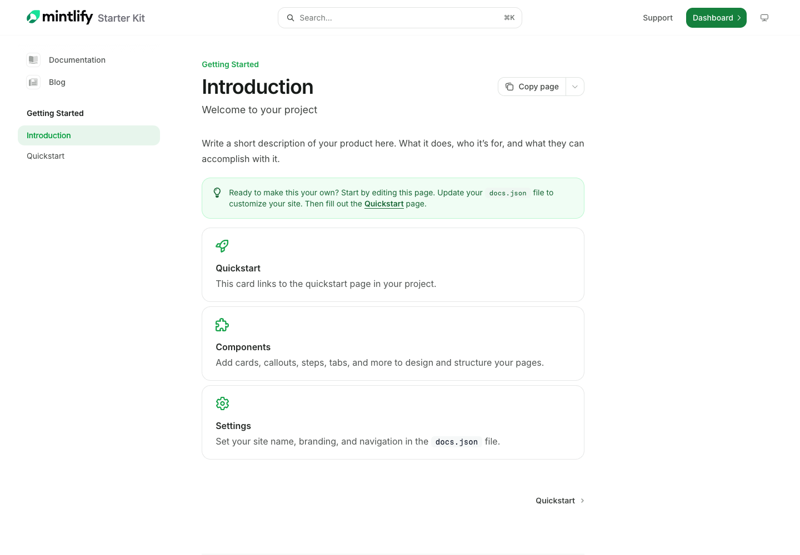
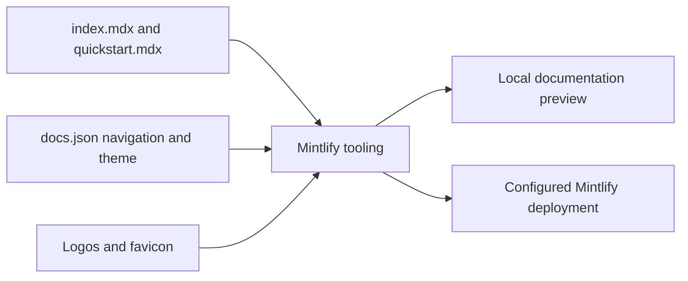

# Documentation Site Starter

A Mintlify documentation scaffold with an introduction page, a quickstart page, and shared branding configuration.



[Quick start](#quick-start) · [Project map](#project-map) · [Verification](verification/VERIFICATION.md)

## Current state

This repository is an **uncustomized starter**, not documentation for a finished named product. `docs.json` still names the site “Mintlify Starter Kit,” and both MDX pages contain example instructions and placeholders.

Use it as a starting point for a product’s documentation. Before publishing, replace the product description, setup examples, branding, navigation, and support links with real information. `AGENTS.md` also contains terminology and content-boundary placeholders that the project owner should customize.

## Quick start

You need Git and Node.js **20.17 or newer**, as required by the [Mintlify CLI](https://www.mintlify.com/docs/installation).

```bash
git clone https://github.com/Skp693/docs.git
cd docs
npm install --global mint
mint dev
```

Open the local address printed by the CLI, normally **http://localhost:3000**. The repository has no `package.json`, dependency lockfile, or `npm run dev` command; `mint` supplies the preview tooling.

## What to edit first

1. Set the real site name, logos, favicon, navigation, and support destinations in `docs.json`.
2. Replace `index.mdx` with a short product introduction and links to first tasks.
3. Replace `quickstart.mdx` with a tested path from installation to a useful result.
4. Customize `AGENTS.md` with product terminology and documentation boundaries.
5. Preview, validate, and check links before publishing.

```bash
mint validate
mint broken-links
```

The CLI’s [official command reference](https://www.mintlify.com/docs/cli) describes preview and validation options. A successful build validates the documentation structure; it does not verify that placeholder product commands work.

## How the site works



## Project map

| File or folder | Purpose |
| --- | --- |
| `docs.json` | Site name, theme, colors, navigation, logos, navbar, contextual actions, and footer links. |
| `index.mdx` | Starter introduction with links to the quickstart and Mintlify resources. |
| `quickstart.mdx` | Placeholder prerequisites and setup steps to replace with real product instructions. |
| `logo/light.svg`, `logo/dark.svg` | Logo variants selected by theme. |
| `favicon.svg` | Browser tab icon. |
| `AGENTS.md` | Writing guidance for documentation assistants, including active voice and sentence-case headings. |
| `LICENSE` | MIT license supplied with the starter. |
| `.gitignore` | Files excluded from version control. |

See the [complete file inventory](verification/FILE_GUIDE.md).

## Publishing

Connect this repository to the intended Mintlify project and configure its GitHub integration. Publishing is separate from running the local CLI. The documentation review did not create an account, connect a new publishing project, or establish a live documentation URL.

## Verification

`mint validate` passed for the reviewed snapshot on **28 October 2026, Asia/Dubai**. The pages were inspected as starter content. A build pass does not mean the product examples are real, and the [silent preview recording](verification/media/walkthrough.mp4) shows the uncustomized documentation scaffold. See [verification details](verification/VERIFICATION.md).

## Contributing and support

Keep instructions task-oriented, use descriptive image alt text, and tag code blocks with their language. Run the checks above after editing. Open project-specific problems in [issues](https://github.com/Skp693/docs/issues); use [Mintlify documentation](https://www.mintlify.com/docs) for platform questions.

## License

MIT. See [LICENSE](LICENSE) for the original notice and terms.
